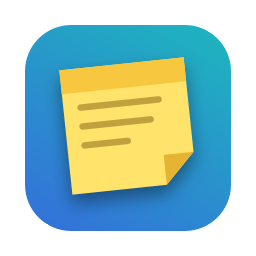
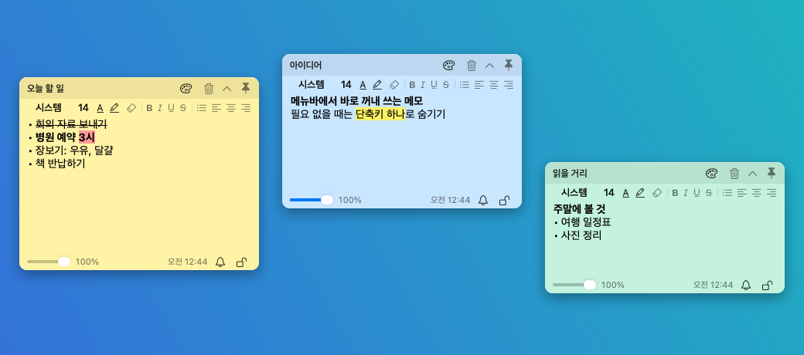

<p align="center"></p>

<h1 align="center">Floaty</h1>

<p align="center">Floating sticky notes, right from the macOS menu bar</p>

<p align="center"><a href="README.md">한국어</a> · English</p>

<p align="center"></p>

Keep notes floating above other apps, and hide them all with one shortcut when you don't need them. Floaty lives in the menu bar only; it adds no Dock icon.

## Features

- **Always on top:** Toggle it per sticky with the pin. Opacity is adjustable per sticky too.
- **Rich text:** Font, size, text color, highlight, bold, italic, underline, strikethrough, bullets, checklists (click ☐ to check it), alignment, and clear formatting. Paste images, and addresses become clickable links. ⌘⇧F finds text inside a sticky.
- **Collapse and hide:** Keep only the title row, or hide stickies, one at a time or all at once.
- **Global shortcuts:** Create, collapse, or hide stickies while using any app. You choose the keys.
- **Alarms:** At the set time, the sticky comes to the front, plays a sound, and flashes. Snooze for 5 minutes or repeat daily.
- **Lock:** Content stays covered until you unlock it with Touch ID or your Mac login password.
- **Manage Stickies window:** See every note in a list and edit them in one window. Hidden stickies work like a notepad here, and search and the Trash (emptied after 30 days) live here too.
- **Files:** Save stickies as RTFD, RTF, or plain text, import them, and print them.
- **Customize:** 10 colors, light and dark themes, date formats, and sound effects per action.
- **Korean and English:** Choose the language in Settings. It follows your Mac's language at first.

For a countdown timer and daily alarm clock with a flip-clock look, see the companion app [Clocky](https://github.com/eddieee-git/mac-app-clocky).

## Requirements

- A Mac with Apple silicon (M1 or later). Intel Macs are not supported.
- macOS 13 or later. Developed and tested on macOS 26.

## Install

1. Download `Floaty.dmg` from [Releases](https://github.com/eddieee-git/mac-app-floaty/releases).
2. Open the dmg and drag Floaty to the Applications folder.
3. Open Floaty.

> [!IMPORTANT]
> **macOS shows a security warning the first time you open Floaty.** Floaty is free and isn't notarized through Apple's paid developer program.
>
> Close the warning, then go to **System Settings → Privacy & Security** and click **Open Anyway** near the bottom. You only need to do this once.

See the [installation guide](docs/install.en.md) for details, updating, and uninstalling.

## Getting started

1. On first launch, a **Getting Started with Floaty** sticky appears. Click the pinned-note icon in the menu bar and choose **New Sticky**.
2. Type your note. It saves automatically.
3. Drag the title row to put it where you want.
4. Press **⌃⌘H** to hide every sticky; press it again to bring them back.

See the [user guide](docs/guide.en.md) for everything else.

## Build it yourself

Only the Command Line Tools are needed, not Xcode.

```bash
scripts/build-app.sh
```

This creates `build/Floaty.app` and `build/Floaty.dmg`.

## Good to know

- Stickies are stored only on this Mac. Nothing is sent to a server, and there is no iCloud sync. The last 7 days are backed up automatically, once a day.
- The body of a locked note is encrypted on disk (the key is in your login keychain). Titles are not encrypted, and other apps running under your account are not blocked.
- The app is signed with the hardened runtime. It has no third-party libraries and sends nothing over the internet.

## License

[MIT](LICENSE)
