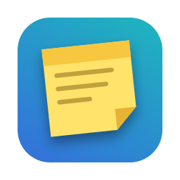
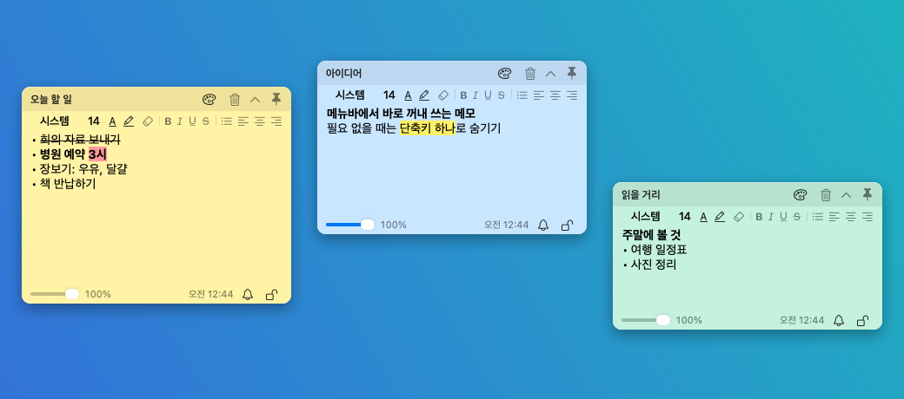

<p align="center"></p>

<h1 align="center">Floaty</h1>

<p align="center">macOS 메뉴바에서 바로 꺼내 쓰는 플로팅 스티커 메모</p>

<p align="center">한국어 · <a href="README.en.md">English</a></p>

<p align="center"></p>

다른 앱 위에 메모를 띄워 두고, 필요 없을 때는 단축키 하나로 숨깁니다. Dock에 아이콘이 생기지 않고 메뉴바에만 상주합니다.

## 주요 기능

- **항상 위에 띄우기:** 스티커마다 핀으로 켜고 끕니다. 투명도도 스티커별로 조절합니다.
- **서식 있는 메모:** 글씨체, 크기, 글자색, 형광펜, 굵게, 기울임, 밑줄, 취소선, 글머리표, 체크리스트(☐ 누르면 ☑), 정렬, 서식 지우기를 지원합니다. 이미지도 붙여 넣을 수 있고, 주소는 누를 수 있는 링크로 바뀝니다. ⌘⇧F로 스티커 안에서 찾습니다.
- **접기와 숨기기:** 제목 줄만 남기거나 숨깁니다. 스티커 하나만, 또는 모두 한 번에 할 수 있습니다.
- **전역 단축키:** 어떤 앱을 쓰고 있어도 새 스티커를 만들고 스티커를 접거나 숨깁니다. 키는 직접 정합니다.
- **알람:** 정해진 시각이 되면 스티커가 앞으로 나와 소리를 내고 깜빡입니다. 5분 뒤 다시 알림과 매일 반복도 됩니다.
- **잠금:** Touch ID나 Mac 로그인 암호로 풀기 전까지 내용을 화면에서 가립니다.
- **스티커 관리 창:** 모든 메모를 목록으로 보고 한 창에서 편집합니다. 숨긴 스티커는 메모장처럼 여기서만 쓸 수 있고, 검색과 휴지통(30일 뒤 자동 비움)도 여기서 합니다.
- **파일:** 스티커를 RTFD, RTF, 텍스트로 저장하고 불러오며 인쇄합니다.
- **꾸미기:** 10가지 색, 라이트·다크 테마, 날짜 표기 방식, 동작별 효과음을 고릅니다.
- **한국어·영어:** 설정에서 화면 언어를 고릅니다. 처음에는 Mac의 언어를 따릅니다.

넘김시계 모양의 타이머와 알람, 캘린더 일정 알림은 짝꿍 앱 [Clocky](https://github.com/eddieee-git/mac-app-clocky)에 있습니다.

## 요구 사항

- Apple 실리콘 Mac (M1 이상). Intel Mac은 지원하지 않습니다.
- macOS 13 이상. 개발과 시험은 macOS 26에서 했습니다.

## 설치

1. [Releases](https://github.com/eddieee-git/mac-app-floaty/releases)에서 `Floaty.dmg`를 내려받습니다.
2. dmg를 열고 Floaty를 Applications 폴더로 끌어다 놓습니다.
3. Floaty를 실행합니다.

> [!IMPORTANT]
> **처음 실행할 때 macOS 보안 경고가 나옵니다.** Floaty는 무료로 배포하는 앱이라 Apple의 유료 개발자 인증(공증)을 받지 않았기 때문입니다.
>
> 경고 창을 닫은 뒤 **시스템 설정 → 개인정보 보호 및 보안**의 아래쪽에서 **그래도 열기**를 누르면 됩니다. 처음 한 번만 하면 됩니다.

자세한 내용은 [설치 안내](docs/install.md)를 보세요. 업데이트와 삭제 방법도 있습니다. 버전별 변경 내용은 [변경 기록](CHANGELOG.md)에 있습니다.

## 시작하기

1. 처음 실행하면 **Floaty 시작하기** 안내 스티커가 뜹니다. 메뉴바의 압정 꽂힌 메모지 아이콘을 누르고 **새 스티커**를 고릅니다.
2. 내용을 입력합니다. 저장은 자동으로 됩니다.
3. 제목 줄을 끌어 원하는 곳에 둡니다.
4. **⌃⌘H**를 누르면 모든 스티커가 숨고, 다시 누르면 나타납니다.

자세한 내용은 [사용법](docs/guide.md)을 보세요. English: [README](README.en.md) · [User Guide](docs/guide.en.md)

## 직접 빌드하기

Xcode 없이 Command Line Tools만 있으면 됩니다.

```bash
scripts/build-app.sh
```

`build/Floaty.app`과 `build/Floaty.dmg`가 만들어집니다.

## 알아 두기

- 스티커는 이 Mac에만 저장됩니다. 서버로 보내지 않으며 iCloud 동기화도 없습니다. 하루에 한 번 최근 7일치를 자동으로 백업합니다.
- 잠긴 메모의 본문은 파일에도 암호화해서 저장합니다(키는 로그인 키체인). 제목은 암호화하지 않으며, 내 계정으로 도는 다른 앱까지 막지는 못합니다.
- 앱은 강화 런타임을 켜서 서명합니다. 외부 라이브러리가 없습니다.
- 인터넷은 새 버전 확인에만 씁니다. 하루에 한 번 GitHub에 최신 버전 번호를 묻고, 업데이트를 누르면 새 dmg를 받습니다. 스티커 내용이나 사용 기록은 보내지 않으며, 자동 확인은 설정 → 일반에서 끌 수 있습니다.

## 라이선스

[MIT](LICENSE)
