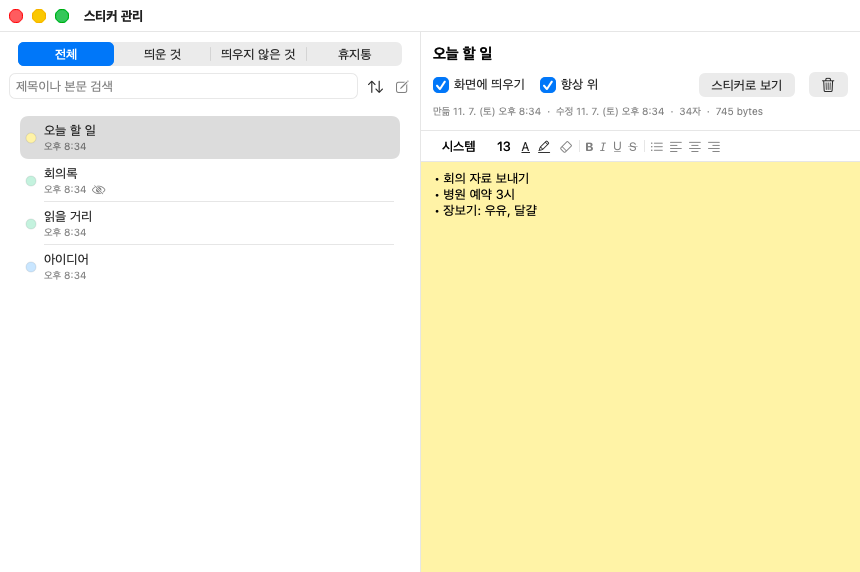
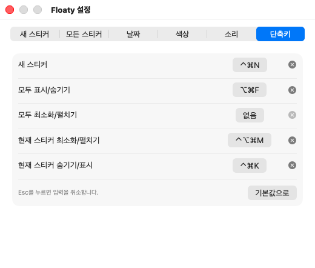

# User Guide

[← Back to README](../README.en.md) · [한국어 사용법](guide.md)

- [Layout](#layout)
- [Writing notes](#writing-notes)
- [Collapsing and hiding](#collapsing-and-hiding)
- [Alarms](#alarms)
- [Locking](#locking)
- [Manage Stickies window](#manage-stickies-window)
- [Save, import, and print](#save-import-and-print)
- [Keyboard shortcuts](#keyboard-shortcuts)
- [Settings](#settings)
- [FAQ](#faq)

The screenshots show the Korean interface. Switch the app to English in **Settings → General → Language**; the change applies right away.

## Layout

Click the **menu bar icon** to open this menu. Hold ⌥ while clicking to create a new sticky right away instead.

| Group | Items |
|---|---|
| Create and find | New Sticky, Manage Stickies…, Stickies ▸ (every sticky; visible ones are checked) |
| All stickies | Show/Hide All, Collapse/Expand All, Lock All Again (only when a sticky is locked) |
| File | File ▸ Import… / Save All… / Show Backups Folder |
| App | Settings…, Check for Updates… (opens the Releases page), Quit Floaty |

A **sticky** has three rows.

| Row | Contents |
|---|---|
| Title row | Title, pin, palette menu, collapse, trash |
| Format row | Font, size, text color, highlight, clear formatting, text style, bullets, checklist, alignment |
| Bottom row | Opacity, modified time or character count, alarm, lock |

- **Move:** Drag the title row. When you let go within 10 pt of a screen edge or another sticky, it snaps into line (with an 8 pt gap when placed side by side).
- **Switch stickies:** In a sticky, press ⌘\` for the next sticky or ⌘⇧\` for the previous one, ready to type.
- **Resize:** Drag the edges.
- **Multiple displays:** New stickies open near the middle of the display the pointer is on. Stickies move freely between displays and can sit across two. If a sticky ends up off screen, for example when you unplug an external display from a MacBook, it moves onto a remaining display (collapsed stickies stay collapsed).
- **Always on top:** The pin button keeps a sticky above other apps, or lets it fall behind like a normal window.
- **Color and title:** Pick a color from the palette button; each color has a swatch, and the current one is checked. Click the title of the sticky in front to rename it, or use **Rename** in the palette menu. If the title is empty, the first line of the note is used (without bullets or checkboxes).
- **Duplicate:** **Duplicate** (⌘D) in the palette menu copies formatting and images too.
- **Bottom row display:** Double-click the modified time or character count to switch between them. Hover for details.

## Writing notes

Notes save automatically when you stop typing.

Select text, then use the format row buttons or shortcuts. If nothing is selected, the format applies to what you type next.

**Clear Formatting** (eraser button, ⌘\\) resets text formatting and alignment. With a selection it clears only the selection; otherwise the whole note. Bullets and images stay, and ⌘Z undoes it.

**Checklist** (checklist button, ⌘⇧L) puts ☐ in front of the selected lines. Click ☐ to check it (☑); the line turns gray with a strikethrough. Click again to uncheck. Press Return on a checklist line to start the next line with an empty ☐; press it again on an empty line to end the list. Press the button again to remove the boxes; on bullet lines it turns them into a checklist.

**Links** become clickable automatically when you type or paste an address. Click one to open it in your browser. Links that aren't web or mail addresses (ones that open a file or another app) show the real address and ask first.

**Find:** Press ⌘⇧F inside a sticky to show a find bar above the note. ⌘G and ⌘⇧G go to the next and previous match.

**Text size:** ⌘= and ⌘− make the selected text (or what you type next) one size bigger or smaller.

**Images** can be pasted or dropped in. They are shown scaled to the sticky width, but the original is saved.

**Paste Without Formatting** is in the right-click menu, or press ⌥⇧⌘V.

## Collapsing and hiding

| Action | Result | How |
|---|---|---|
| Collapse | Only the title row remains | Collapse button, double-click the title |
| Hide | The sticky disappears from the screen | **Hide** in the palette menu |
| Hide all | Every sticky disappears or comes back | **Show/Hide All** in the menu bar, ⌃⌘H |
| Collapse all | Collapses all if any is expanded; expands all if all are collapsed | **Collapse/Expand All** in the menu bar, ⌃⌘M |

Reopen a hidden sticky from the **Stickies** list in the menu bar. While everything is hidden, the note in the menu bar icon is drawn with a dashed outline.

Position, size, collapsed and hidden state survive quitting the app and restarting the Mac.

You can also set shortcuts that collapse or hide just one sticky. See [Keyboard shortcuts](#keyboard-shortcuts).

## Alarms

Use the bell button in the bottom row, or **Alarm** in the palette menu, to choose 5, 10, 15, or 30 minutes, 1 hour, or a specific date and time. In **Choose Date and Time…**, turn on **Repeat Daily** to ring at that time every day; dismissing it moves it to the same time tomorrow.

When the time comes, the sticky comes to the front, plays a sound, also posts to Notification Center (Floaty asks for permission the first time you set an alarm; clicking the notification brings the sticky forward; turn it off in Settings → Sounds), and flashes until you click anywhere on it or click **Dismiss Alarm**. While it rings, **In 5 Minutes** reminds you again in five minutes; you can also pick another time from **Alarm** in the palette menu. Alarms that pass while the app is not running ring the next time it starts.

## Locking

Click the lock button in the bottom row to lock right away. When locked, click it, or anywhere on the hidden content, to unlock with Touch ID or your Mac login password. When unlocked, click it to cover the content again. To remove the lock entirely, press and hold the lock or choose **Remove Lock** in the palette menu.

- Content is covered again when the app restarts, the screen locks, or the Mac goes to sleep.
- **Lock All Again** in the menu bar covers everything immediately.
- While locked, a sticky is excluded from duplicating, saving to a file, printing, and text search.

The body of a locked note is also encrypted on disk. The key lives in your login keychain, so copying the note files or restoring them from a backup does not reveal the content.

> [!WARNING]
> Other apps running under your account on this Mac can read the key from the keychain, so this does not protect against them. A free app cannot use Apple's app-only key storage. Titles are not encrypted.

## Manage Stickies window

Open it with **Manage Stickies…** in the menu bar, or press ⌘F in a sticky. All notes are listed on the left; the selected note's details and editor are on the right.

- **Views:** Choose **All**, **Visible**, **Hidden**, or **Trash** at the top. While everything is hidden with ⌃⌘H, a **All hidden** notice with a **Show Again** button appears above the list.
- **Search and sort:** The search field matches titles and note text. Matches are highlighted in the list and the editor, and when only the note text matches, the list shows that part on one line. Locked notes match by title only. Sort by modified date, created date, or title.
- **Editing:** The editor on the right shares the text with the sticky; changes show up in both immediately. You can also change the title, color, and always-on-top here.
- **Use it like a notepad:** The pencil button (⌘N in this window) creates a hidden sticky that stays out of the way and is edited only here. Turn off **Hide** to show it as a sticky; turn it on to hide it again.
- **Show Sticky:** Unhides and expands the sticky and brings it to the front. Double-clicking it in the list does the same.
- **Locked notes:** The content stays covered until you click **Unlock** and use Touch ID or your password.

### Trash

Deleted stickies go to the Trash. A new installation deletes without asking and shows Undo instead (turn on **Confirm before deleting** in Settings → General if you prefer). Empty stickies are deleted without asking. When you delete one with content, an **Undo** notice appears where it was for six seconds; click it to bring the sticky back in the same place. In the **Trash** view you can read notes, **Restore** them (or double-click), or **Delete Permanently**. **Empty Trash** is below the list. Notes in the Trash can't be edited; restore them first. Notes are deleted automatically 30 days after they go to the Trash (you can turn this off in Settings → General). Permanent deletion can't be undone.

Select several notes with ⌘ or ⇧ to show, hide, move to Trash, or change the color of all of them at once. In the Trash, you can restore or permanently delete several at once.

## Save, import, and print

- **Save to File:** **Save to File…** (⌘S) in the palette menu. Choose RTFD, RTF, or plain text. Use RTFD to keep images.
- **Save All:** **File → Save All…** in the menu bar, then choose a folder.
- **Import:** **File → Import…** in the menu bar. Each file becomes a new sticky.
- **Print:** **Print…** (⌘P) in the palette menu prints the title and note on white paper.

### Automatic backups

Once a day, Floaty copies the sticky list and note bodies to `~/Library/Application Support/Floaty/Backups/<date>` and keeps the last 7 days. Open it with **File → Show Backups Folder** in the menu bar. Locked notes are copied still encrypted.

If the list file is damaged and can't be read, Floaty doesn't overwrite it. It sets it aside as `notes-unreadable-<time>.json`, restores the list from the most recent backup, and tells you.

To restore by hand, quit Floaty, copy `notes.json` and the `bodies` folder from the date folder you want over the ones in the `Floaty` folder, and open Floaty again.

## Keyboard shortcuts

### Global shortcuts

These work while you use other apps. In **Settings → Shortcuts**, click an item's button and press the keys you want.

| Item | Default |
|---|---|
| New Sticky | ⌃⌘N |
| Show/Hide All | ⌃⌘H |
| Collapse/Expand All | ⌃⌘M |
| Collapse/Expand Current Sticky | ⌃⌥M |
| Hide/Show Current Sticky | ⌃⌥H |
| Delete Current Sticky | ⌃⌘⌫ |

The **current sticky** is the one you last clicked or typed in. Right after the app starts, these do nothing until you click a sticky. Pressing the hide shortcut again brings the hidden sticky back. The delete shortcut only moves visible stickies to the Trash, and pressing it repeatedly won't delete another one until you click a different sticky.

### Shortcuts inside a sticky

| Action | Keys | Action | Keys |
|---|---|---|---|
| Bold | ⌘B | Bullets | ⌘7 |
| Italic | ⌘I | Align Left | ⌘{ |
| Underline | ⌘U | Center | ⌘\| |
| Strikethrough | ⌘⇧X | Align Right | ⌘} |
| Clear Formatting | ⌘\\ | Fonts window | ⌘T |
| Next / Previous Sticky | ⌘\` / ⌘⇧\` | | |
| Checklist | ⌘⇧L | Find in Sticky | ⌘⇧F (next ⌘G) |
| Paste Without Formatting | ⌥⇧⌘V | Manage Stickies (search) | ⌘F |
| Duplicate | ⌘D | Save to File | ⌘S |
| Bigger / Smaller text | ⌘= / ⌘− | | |
| Print | ⌘P | Undo | ⌘Z |

## Settings

Open with menu bar icon → **Settings…**.

| Tab | Contents |
|---|---|
| General | Language (Korean or English, applies immediately), theme, open at login, confirm before deleting, empty Trash after 30 days (on by default) |
| Stickies | Default size, font, text size, always on top, and color (random or fixed) for new stickies. Opacity and bottom-row display for all stickies |
| Date | Date, year, weekday, and time formats. Changing the language also switches language-specific formats, such as "Fri" and "3:05 PM" |
| Colors | Title row and background colors for the 10 colors, set separately for light and dark |
| Sounds | Sound effects (off by default; alarm sounds always play), send alarms to Notification Center (on by default) and a sound for each action: a system sound, none, or your own sound file |
| Shortcuts | Global shortcuts |

## FAQ

**I opened the app but don't see anything.**
There is no Dock icon. Look at the menu bar at the top of the screen. If the menu bar is crowded, the icon may be hidden.

**A warning appears the first time I open it.**
See the [installation guide](install.en.md#the-security-warning-on-first-launch).

**A shortcut won't record.**
Check the red message at the bottom of the window. A key used by another item, or a key without ⌘, ⌃, or ⌥, can't be assigned. If nothing happens at all, macOS or another app may already use that combination; try a different one.

**My own sound file doesn't play.**
Sound files aren't copied; Floaty remembers where they are. If you move or delete the file, the default sound is used.

**What happens if I open Floaty twice?**
If it's already running, the new copy quits right away and the running one shows the Manage Stickies window, so two copies never overwrite each other's files.

**Where are stickies stored?**
In `~/Library/Application Support/Floaty`. The [installation guide](install.en.md#moving-to-another-mac) explains how to move them to another Mac.
