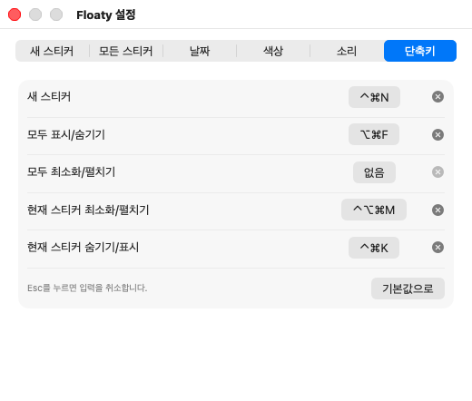

# 사용법

[← README로 돌아가기](../README.md)

- [화면 구성](#화면-구성)
- [메모 쓰기](#메모-쓰기)
- [접기와 숨기기](#접기와-숨기기)
- [알람](#알람)
- [잠금](#잠금)
- [찾기와 휴지통](#찾기와-휴지통)
- [파일로 저장·불러오기·인쇄](#파일로-저장불러오기인쇄)
- [단축키](#단축키)
- [설정](#설정)
- [자주 묻는 질문](#자주-묻는-질문)

## 화면 구성

**메뉴바 아이콘**을 누르면 새 스티커, 모두 숨기기, 스티커 목록, 찾기, 휴지통, 설정, 종료 메뉴가 나옵니다.

**스티커**는 세 줄로 되어 있습니다.

| 위치 | 내용 |
|---|---|
| 제목 줄 | 제목, 핀, 팔레트 메뉴, 접기, 휴지통 |
| 서식 줄 | 글씨체, 크기, 글자색, 형광펜, 서식 지우기, 글자 모양, 글머리표, 정렬 |
| 아래 줄 | 투명도, 수정 시각 또는 글자수, 알람, 잠금 |

- **이동:** 제목 줄을 끕니다.
- **크기 조절:** 스티커 가장자리를 끕니다.
- **항상 위:** 핀 버튼을 누르면 다른 앱 위에 계속 떠 있거나 일반 창처럼 뒤로 갑니다.
- **색과 제목:** 팔레트 버튼에서 색을 고르고 **제목 변경**을 누릅니다. 제목을 비워 두면 본문 첫 줄이 이름으로 쓰입니다.
- **복제:** 팔레트 메뉴의 **복제**(⌘D)는 서식과 이미지까지 복사합니다.
- **아래 줄 표시 바꾸기:** 수정 시각이나 글자수를 더블클릭하면 서로 바뀝니다. 마우스를 올리면 자세한 정보가 보입니다.

## 메모 쓰기

내용은 입력을 멈추면 자동으로 저장됩니다.

서식은 글자를 선택한 뒤 서식 줄의 버튼이나 단축키로 적용합니다. 선택하지 않고 적용하면 이어서 입력하는 글자에 쓰입니다.

**서식 지우기**(지우개 버튼, ⌘\\)는 글자 서식과 정렬을 기본값으로 되돌립니다. 글자를 선택하면 선택한 부분만, 선택하지 않으면 본문 전체를 지웁니다. 글머리표와 이미지는 남고, ⌘Z로 되돌릴 수 있습니다.

**이미지**는 붙여 넣거나 끌어다 놓습니다. 스티커 폭에 맞춰 작게 보이지만 원본은 그대로 저장됩니다.

**서식 없이 붙여넣기**는 오른쪽 클릭 메뉴나 ⌥⇧⌘V로 합니다.

## 접기와 숨기기

| 동작 | 결과 | 방법 |
|---|---|---|
| 접기 | 제목 줄만 남습니다 | 접기 버튼, 제목 더블클릭 |
| 숨기기 | 화면에서 사라집니다 | 팔레트 메뉴의 **숨기기** |
| 모두 숨기기 | 모든 스티커가 사라지거나 다시 나타납니다 | 메뉴바의 **모두 표시/숨기기**, ⌥⌘F |
| 모두 접기 | 하나라도 펼쳐져 있으면 모두 접고, 모두 접혀 있으면 모두 펼칩니다 | 메뉴바의 **모두 최소화/펼치기** |

숨긴 스티커는 메뉴바의 **스티커** 목록에서 골라 다시 엽니다.

스티커 하나만 접거나 숨기는 단축키도 지정할 수 있습니다. [단축키](#단축키)를 보세요.

## 알람

아래 줄의 종 버튼이나 팔레트 메뉴의 **알람**에서 5·10·15·30분 후, 1시간 후, 또는 원하는 날짜와 시각을 고릅니다.

시각이 되면 그 스티커가 앞으로 나와 소리를 내고, **알람 확인**을 누를 때까지 깜빡입니다. 앱이 꺼져 있는 동안 지난 알람은 다음에 앱을 켤 때 울립니다.

## 잠금

아래 줄의 자물쇠 버튼으로 스티커를 잠급니다. 풀 때는 Touch ID나 Mac 로그인 암호를 씁니다.

- 앱을 다시 켜거나, 화면이 잠기거나, Mac이 잠자기에 들어가면 다시 가려집니다.
- 메뉴바의 **모두 다시 잠그기**로 바로 가릴 수도 있습니다.
- 잠긴 동안에는 복제, 파일 저장, 인쇄, 본문 검색에서 제외됩니다.

> [!WARNING]
> 잠금은 화면에서 가리는 기능입니다. 저장된 파일을 암호화하지 않으므로, 이 Mac의 파일에 접근할 수 있는 사람은 내용을 볼 수 있습니다.

## 찾기와 휴지통

**찾기**(⌘F)는 숨긴 스티커를 포함해 제목과 본문을 검색합니다. 결과를 더블클릭하거나 Enter를 누르면 그 스티커가 열립니다.

스티커를 삭제하면 **휴지통**으로 갑니다. 메뉴바의 **휴지통…**에서 되살리거나(더블클릭), 영구 삭제하거나, 비울 수 있습니다. 영구 삭제는 되돌릴 수 없습니다.

## 파일로 저장·불러오기·인쇄

- **파일로 저장:** 팔레트 메뉴의 **파일로 저장…**(⌘S). RTFD, RTF, 텍스트 중에서 고릅니다. 이미지까지 보존하려면 RTFD를 쓰세요.
- **모두 저장:** 메뉴바의 **모두 파일로 저장…**에서 폴더를 고릅니다.
- **불러오기:** 메뉴바의 **파일에서 불러오기…**. 파일마다 새 스티커가 만들어집니다.
- **인쇄:** 팔레트 메뉴의 **인쇄…**(⌘P). 제목과 본문을 흰 종이에 인쇄합니다.

## 단축키

### 전역 단축키

다른 앱을 쓰는 중에도 동작합니다. **설정 → 단축키**에서 항목의 버튼을 누르고 원하는 키를 입력합니다.

| 항목 | 기본값 |
|---|---|
| 새 스티커 | 없음 |
| 모두 표시/숨기기 | ⌥⌘F |
| 모두 최소화/펼치기 | 없음 |
| 현재 스티커 최소화/펼치기 | 없음 |
| 현재 스티커 숨기기/표시 | 없음 |

**현재 스티커**는 마지막으로 클릭하거나 입력한 스티커입니다. 앱을 켠 뒤 아직 누른 스티커가 없으면 동작하지 않습니다. 숨기기 단축키를 다시 누르면 숨긴 스티커가 돌아옵니다.

### 스티커 안에서 쓰는 단축키

| 동작 | 키 | 동작 | 키 |
|---|---|---|---|
| 굵게 | ⌘B | 글머리표 | ⌘7 |
| 기울임 | ⌘I | 왼쪽 정렬 | ⌘{ |
| 밑줄 | ⌘U | 가운데 정렬 | ⌘\| |
| 취소선 | ⌘⇧X | 오른쪽 정렬 | ⌘} |
| 서식 지우기 | ⌘\\ | 글씨체 창 | ⌘T |
| 서식 없이 붙여넣기 | ⌥⇧⌘V | 찾기 | ⌘F |
| 복제 | ⌘D | 파일로 저장 | ⌘S |
| 인쇄 | ⌘P | 실행 취소 | ⌘Z |

## 설정

메뉴바 아이콘 → **설정…**에서 엽니다.

| 탭 | 내용 |
|---|---|
| 새 스티커 | 기본 크기, 글씨체, 글자 크기, 항상 위, 색상(랜덤 또는 고정) |
| 모든 스티커 | 투명도, 아래 줄 기본 표시, 로그인 시 자동 실행, 삭제 확인, 테마 |
| 날짜 | 날짜·연도·요일·시각 표기 방식 |
| 색상 | 10가지 색의 제목 줄과 바탕 색. 라이트와 다크를 따로 정합니다 |
| 소리 | 동작별 소리. 시스템 사운드, 없음, 내 소리 파일 중에서 고릅니다 |
| 단축키 | 전역 단축키 |

## 자주 묻는 질문

**앱을 켰는데 아무것도 안 보입니다.**
Dock에는 아이콘이 없습니다. 화면 위쪽 메뉴바를 보세요. 메뉴바 항목이 많으면 아이콘이 가려질 수 있습니다.

**처음 실행할 때 경고가 나옵니다.**
[설치 안내](install.md#처음-실행할-때-나오는-보안-경고)를 보세요.

**단축키가 입력되지 않습니다.**
창 아래쪽의 빨간 안내를 확인하세요. 다른 항목이 쓰는 키이거나, ⌘·⌃·⌥ 없이 누른 키는 지정할 수 없습니다. 아무 반응이 없으면 macOS나 다른 앱이 먼저 쓰는 키일 수 있으니 다른 조합을 쓰세요.

**내 소리 파일이 안 나옵니다.**
소리 파일은 복사하지 않고 위치만 기억합니다. 파일을 옮기거나 지우면 기본 소리로 돌아갑니다.

**스티커는 어디에 저장되나요?**
`~/Library/Application Support/Floaty`에 저장됩니다. 옮기는 방법은 [설치 안내](install.md#다른-mac으로-옮기기)에 있습니다.
